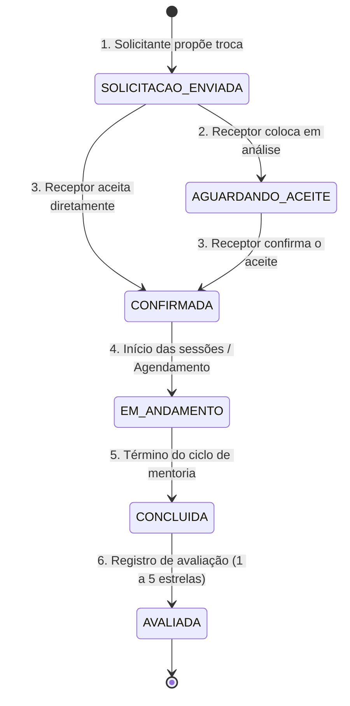

# 🎓 SkillSwap — Rede Acadêmica de Troca de Conhecimentos

O **SkillSwap** é uma plataforma acadêmica e colaborativa onde estudantes, pesquisadores e mentores compartilham competências e aprendem de forma recíproca **sem envolver dinheiro**.

Se **Felipe** domina **Python** e quer aprender **Inglês**, e **Maria** domina **Inglês** e quer aprender **Python**, o motor de compatibilidade identifica a reciprocidade exata, calcula a proximidade geográfica no campus via **Fórmula de Haversine** e guia os dois estudantes por um fluxo pedagógico de **6 etapas** até a certificação no **Histórico de Aprendizagem**.

---

## 📚 Mapa de Conformidade com as Receitas 13 a 23 (Programação Web)

O código-fonte foi inteiro documentado com comentários explicativos referenciando diretamente os conceitos das **Receitas 13 a 23**:

| Receita | Tema Central da Receita | Arquivos de Referência no Projeto |
| :--- | :--- | :--- |
| **Receita 13** | Aplicação Next.js, estrutura `app/` e páginas (`export default` em `page.tsx`) | `package.json`, `src/app/page.tsx`, `src/app/(auth)/login/page.tsx` |
| **Receita 14** | Criação de Componentes (`export function`), passagem de `props` e fronteira Server vs. Client | `src/components/matches/MentorCard.tsx`, `src/components/exchanges/ExchangeStepper.tsx` |
| **Receita 15** | Layouts Hierárquicos (`layout.tsx`) e navegação SPA com `<Link>` de `next/link` | `src/app/layout.tsx`, `src/app/(platform)/layout.tsx`, `src/components/layout/Sidebar.tsx` |
| **Receita 16** | Data Fetching no Servidor, `await searchParams` e renderização de listas com `.map()` e `key` | `src/app/(platform)/discover/page.tsx`, `src/app/(platform)/matches/page.tsx` |
| **Receita 17** | Formulários de Pesquisa GET com `<Form>` de `next/form` sincronizados à URL | `src/components/matches/DiscoverFilters.tsx` (`<Form action="/discover">`) |
| **Receita 18** | Client Components (`"use client"`), gerência de estado com `useState` e eventos de formulário | `src/components/skills/SkillForm.tsx`, `src/components/calendar/MeetingForm.tsx`, `src/components/matches/MatchesApiVerifier.tsx` |
| **Receita 19** | Implementação de API própria (Route Handlers `route.ts` com `GET(request)` e `Response.json`) | `src/app/api/matches/route.ts`, `src/app/api/skills/route.ts`, `src/app/api/calendar/[meetingId]/ics/route.ts` |
| **Receita 20** | Server Actions (`"use server"`) invocadas por formulários para mutações seguras no servidor | `src/actions/auth.ts`, `src/actions/skills.ts`, `src/actions/exchanges.ts`, `src/actions/meetings.ts`, `src/actions/reviews.ts` |
| **Receita 21** | Rotas Dinâmicas (`[id]`), `await params`, UI Streaming (`loading.tsx`), `generateStaticParams` (SSG) e `revalidatePath` (ISR) | `src/app/(platform)/profiles/[id]/page.tsx`, `src/app/(platform)/profiles/[id]/loading.tsx` |
| **Receita 22** | Acesso a Banco de Dados Relacional no Servidor via `.env`, scripts de migração e seed | `prisma/schema.prisma`, `prisma/seed.ts`, `src/lib/prisma.ts`, `.env.example` |
| **Receita 23** | Consumo de API própria conectada ao banco de dados a partir do navegador (`fetch` no cliente) | `src/components/matches/MatchesApiVerifier.tsx` consumindo `GET /api/matches` |

---

## 🛠️ Stack Técnica

- **Framework Full-Stack:** Next.js 15 (App Router) + React 19
- **Linguagem:** TypeScript (`strict: true`)
- **Estilização & UI:** Tailwind CSS (Paleta Acadêmica Slate / Indigo-900 / Emerald-700 / Amber-600) + Tipografia Editorial (`Source Serif 4` + `Inter`) + Ícones `lucide-react`
- **Banco de Dados & ORM:** PostgreSQL 16 (Docker Compose ou Supabase) + Prisma ORM
- **Validação de Dados:** Zod (`src/lib/validators.ts`)
- **Autenticação & Segurança:** JWT (`jose`) armazenado em Cookie `HttpOnly` + Hash de senhas com `bcryptjs` + Proteção de rotas no Edge via `middleware.ts`
- **Geolocalização & Agenda:** Browser Geolocation API + Fórmula de Haversine (`src/lib/geolocation.ts`) + Integração Google Calendar API OAuth2 / Deep Link / Exportação `.ICS` RFC 5545 (`src/lib/google-calendar.ts`)

---

## 📂 Estrutura de Pastas Comentada

```text
SkillSwap/
├── docker-compose.yml              # Container PostgreSQL 16 local pronto para uso
├── .env.example                    # Modelo de variáveis de ambiente (Banco, JWT, Google Calendar)
├── middleware.ts                   # Guardião Edge que protege rotas privadas (/skills, /matches, /exchanges, /calendar)
├── prisma/
│   ├── schema.prisma               # Modelagem relacional: User, Skill, UserSkill, Exchange, Meeting e Review
│   └── seed.ts                     # Popula Felipe, Maria + 4 mentores, 10 disciplinas e 5 trocas em estágios variados
└── src/
    ├── app/                        # Rotas do Next.js App Router (Receitas 13, 15, 16, 19 e 21)
    │   ├── globals.css             # Tokens visuais e classes utilitárias do tema acadêmico
    │   ├── layout.tsx              # RootLayout com fontes Source Serif 4 e Inter
    │   ├── loading.tsx             # Skeleton global de carregamento (UI Streaming)
    │   ├── error.tsx               # Tratamento global de exceções em tempo de execução
    │   ├── not-found.tsx           # Página 404 global
    │   ├── page.tsx                # Landing Page institucional explicando a metodologia em 3 passos
    │   ├── (auth)/                 # Grupo de rotas públicas de autenticação
    │   │   ├── login/page.tsx      # Tela de login com preenchimento rápido de contas demo
    │   │   └── register/page.tsx   # Tela de cadastro com captura de geolocalização
    │   ├── (platform)/             # Grupo de rotas com Layout Acadêmico (Sidebar + Topbar)
    │   │   ├── layout.tsx          # Layout aninhado que carrega usuário logado e contador de pendências
    │   │   ├── loading.tsx         # Skeleton das páginas internas
    │   │   ├── skills/page.tsx     # CRUD completo do portfólio de competências (Ensina vs. Aprende)
    │   │   ├── discover/page.tsx   # Catálogo de mentores filtrado no servidor via searchParams
    │   │   ├── matches/page.tsx    # Sugestões ordenadas pelo algoritmo de reciprocidade e Haversine
    │   │   ├── profiles/[id]/      # Rota dinâmica de Currículo & Histórico de Aprendizagem
    │   │   ├── exchanges/page.tsx  # Painel de trocas em abas com Stepper de 6 estados e avaliações
    │   │   └── calendar/page.tsx   # Agenda de encontros Online/Presenciais com Google Calendar e .ICS
    │   └── api/                    # Route Handlers REST JSON (Receitas 19 e 23)
    │       ├── matches/route.ts    # GET /api/matches — Motor de compatibilidade em JSON
    │       ├── skills/route.ts     # GET /api/skills — Consulta filtrada do catálogo de habilidades
    │       └── calendar/[meetingId]/ics/route.ts # GET /api/calendar/:id/ics — Download de evento .ics
    ├── actions/                    # Server Actions com "use server" e validação Zod (Receita 20)
    │   ├── auth.ts                 # Cadastro, login e logout com cookie HttpOnly
    │   ├── skills.ts               # Criação, atualização de nível/ementa e exclusão de UserSkill
    │   ├── exchanges.ts            # Proposta de troca e transição validada entre os 6 estados
    │   ├── meetings.ts             # Agendamento e cancelamento de encontros
    │   └── reviews.ts              # Avaliação de 1 a 5 estrelas e certificação da troca
    ├── lib/                        # Regras de negócio, banco de dados e utilitários de servidor
    │   ├── prisma.ts               # Singleton do PrismaClient (Receita 22)
    │   ├── auth.ts                 # Assinatura/verificação JWT e extração segura do usuário logado
    │   ├── validators.ts           # Schemas Zod para validação de todas as entradas
    │   ├── matching.ts             # Algoritmo de match (Recíproco Direto, Categoria e Haversine)
    │   ├── geolocation.ts          # Fórmula matemática de Haversine e bônus de proximidade
    │   ├── exchange-state.ts       # Máquina de estados das trocas (6 etapas e permissões)
    │   └── google-calendar.ts      # Sincronização OAuth2, Deep Link Google Calendar e gerador .ICS
    └── components/                 # Componentes modulares de interface (Receitas 14, 17 e 18)
        ├── auth/                   # Formulários interativos de Login e Cadastro
        ├── layout/                 # Sidebar responsiva e Topbar contextual
        ├── skills/                 # Formulário e cards de edição/remoção de habilidades
        ├── matches/                # Fichas de mentores, filtros com next/form e modal de proposta
        ├── exchanges/              # Stepper de 6 etapas, abas, cards de troca e modal de avaliação
        └── calendar/               # Formulário de encontro com GPS e card de exportação de agenda
```

---

## 🔄 Máquina de Estados das Trocas (`ExchangeStatus`)

Toda troca de conhecimentos segue estritamente 6 etapas controladas no servidor por `src/lib/exchange-state.ts`:



---

## 🚀 Como Executar o Projeto Localmente

### Pré-requisitos
- **Node.js** 18+ (ou 20+)
- **Docker** e **Docker Compose** (ou uma URL de conexão PostgreSQL do **Supabase**)

### Passo a Passo

1. **Instale as dependências do projeto:**
   ```bash
   npm install
   ```

2. **Configure as variáveis de ambiente:**
   O arquivo `.env` já está configurado para o banco Docker local. Caso queira recriá-lo a partir do exemplo:
   ```bash
   cp .env.example .env
   ```

3. **Suba o banco de dados PostgreSQL via Docker:**
   ```bash
   docker compose up -d
   ```

4. **Sincronize o schema Prisma e popule o banco com o Seed Acadêmico:**
   ```bash
   npm run db:push
   npm run db:seed
   ```

5. **Inicie o servidor de desenvolvimento:**
   ```bash
   npm run dev
   ```

6. **Acesse no navegador:**
   Abra [http://localhost:3000](http://localhost:3000)

---

## 👤 Contas de Demonstração (Criadas pelo `seed.ts`)

Todas as contas de demonstração utilizam a senha padrão **`123456`** (na tela `/login`, basta clicar nos botões de preenchimento rápido):

| Estudante / Mentor | E-mail | Instituição | Ensina (`TEACH`) | Quer Aprender (`LEARN`) |
| :--- | :--- | :--- | :--- | :--- |
| **Felipe Eduardo** | `felipe@skillswap.edu.br` | Sistemas de Informação — UFRN | Python, Banco de Dados SQL | Inglês, UX/UI Design |
| **Maria Clara Vasconcelos** | `maria@skillswap.edu.br` | Letras Inglês — UFRN | Inglês, Redação Acadêmica | Python, Programação Web |
| **Camila Borges** | `camila@skillswap.edu.br` | Design Digital — UFC | UX/UI Design | Programação Web, Python, Estatística |
| **Lucas Andrade** | `lucas@skillswap.edu.br` | Eng. de Computação — UFPE | Cálculo, Programação Web | UX/UI Design, Inglês |
| **Rafael Mendoza** | `rafael@skillswap.edu.br` | Relações Internacionais — UnB | Espanhol, Redação Acadêmica | Banco de Dados SQL |
| **Helena Duarte** | `helena@skillswap.edu.br` | Ciência de Dados & Música — USP | Estatística Aplicada, Violão | Espanhol, Inglês |
